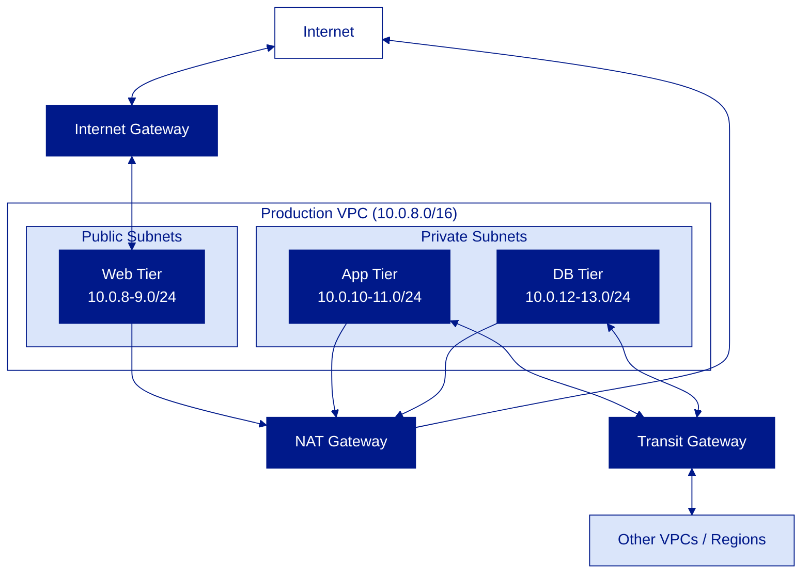

# Regional Network Design



## Traffic Flow

| Traffic Type                | Path                      |
| --------------------------- | ------------------------- |
| Inbound internet            | Internet → IGW → Web Tier |
| Outbound internet (public)  | Web Tier → IGW → Internet |
| Outbound internet (private) | App/DB → NAT → Internet   |
| Cross-VPC / Cross-region    | App/DB → TGW → Other VPCs |

## Route Tables

**Public Subnet (Web Tier):**

```
0.0.0.0/0       → igw-xxx     (internet via IGW)
10.0.8.0/16     → local
10.0.0.0/12     → tgw-xxx     (other VPCs via TGW)
```

**Private Subnets (App/DB Tier):**

```
0.0.0.0/0       → nat-xxx     (internet via NAT)
10.0.8.0/16     → local
10.0.0.0/12     → tgw-xxx     (other VPCs via TGW)
```

Author: Ditah Kumbong
