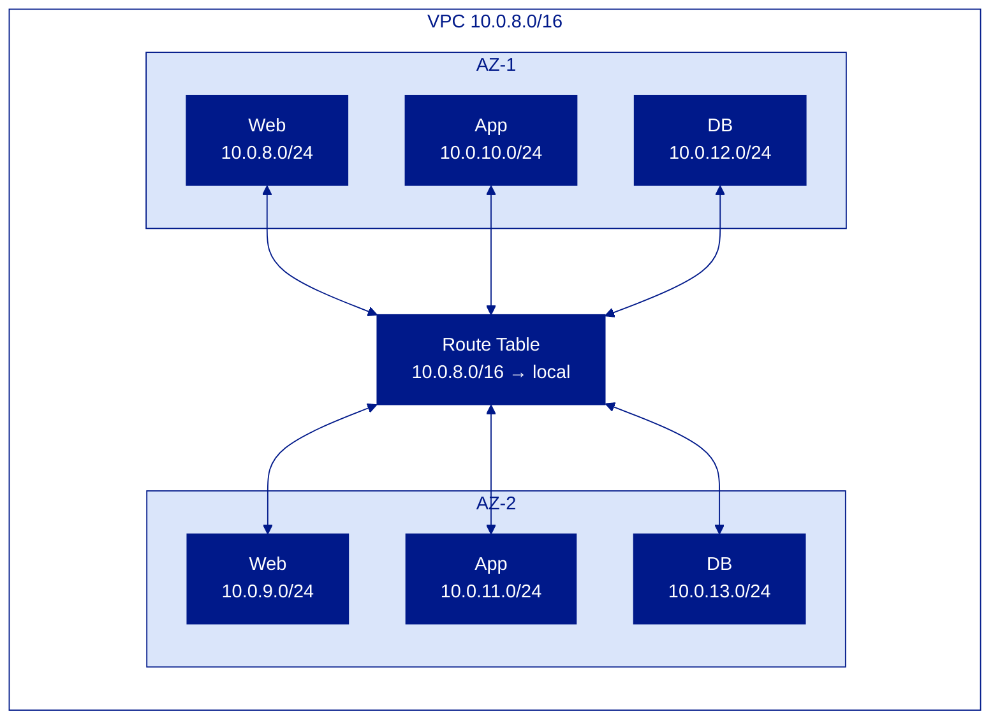

# Availability Zones Design



## Route Table

All subnets share a route table with the VPC CIDR routed locally:

```
Destination     Target
10.0.8.0/16     local    (all subnets can reach each other)
0.0.0.0/0       igw-xxx  (web tier only)
```

## AZ Strategy

- Bidirectional routing between all subnets via local route
- Cross-AZ traffic stays within VPC (no extra hops)
- Each tier can communicate with its replica in the other AZ

Author: Ditah Kumbong
